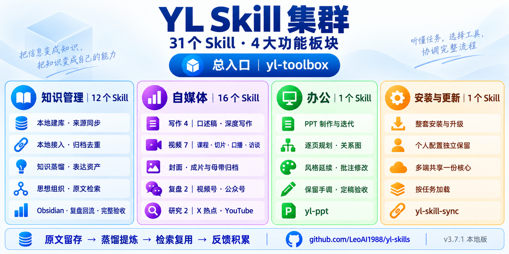
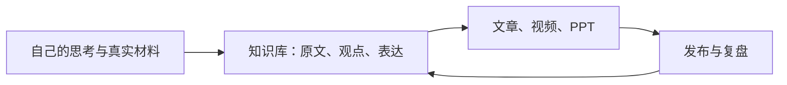

# YL Skills · 把自己的思考变成作品

**当前版本：v3.7.13，共 34 个 Skill，4 大功能板块。** 下图为 v3.7.1 的历史展示图；当前能力与数量以正文、成员目录和发行附件为准。



**面向 Codex、WorkBuddy 等兼容 AI Agent 的中文工作流工具箱：知识管理、内容创作、自动视频剪辑与复盘、PPT。整套安装，按任务调用。**

你负责记录自己的思考，YL 帮你把录音、口述和素材变成文章、视频与课件，再把新作品和复盘结果回流到知识库，形成一个持续滚动的复利系统。

[下载完整工具箱](https://github.com/LeoAI1988/yl-skills/releases/latest) · [安装与版本说明](../README.md) · [成员目录](../yl-toolbox/references/catalog.json) · [反馈问题](https://github.com/LeoAI1988/yl-skills/issues)

**English:** A Chinese-first Agent Skills toolkit for personal knowledge management, source-grounded writing, talking-head video editing, content analytics, and PowerPoint workflows. Install the complete cluster and describe your task in natural language. Codex is the primary installation; compatible hosts such as WorkBuddy can share the same source through mappings.

## 为什么做 YL

> 复杂是执行的天敌。
>
> 人就应该做人应该做的事，机器做机器该做的事。

做自媒体，往往先卡在文案，再卡在拍摄、剪辑和发布。每一步都要学一套工具，下一次又从零走一遍。YL 从这个问题出发，重构了我的内容生产流程。

有想法就记录。说错了、说重复了、卡壳了，都可以继续说，直到把想法完整表达出来。把材料交给 Agent，让它提取逐字稿、整理逻辑、剪辑视频、生成字幕，或者在保留自己语言特点的基础上写成公众号文章。

知识管理是这个系统的中枢：保留原文，提炼观点、方法、案例和表达资产，再把它们用于下一次创作。新的输出也回到知识库，形成一个旋转飞轮。

Skill 之间可以像活字印刷术一样组合。你不必先研究每个成员的名字，告诉总入口你想完成什么，再按任务加载相关能力。



这段介绍改写自作者已发表的《普通人也能0门槛出爆款了》（2026-09-17）和《普通人做好知识管理 开启旋转飞轮》（2026-09-25）。两篇文章可在下方公众号中按标题查找；功能和安装方式以本仓库当前文档与实际发布附件为准。

## 看看它做出来的作品

**这套工具箱就是我自己日常使用的工作流。**

| 去哪里看 | 作者的实际使用情况 | 在微信中怎么找 |
|---|---|---|
| 视频号 **亚里士多翔的AI世界** | 我的视频都是用 YL 自动剪辑的，曾在一个月做出 **10 条爆款** | 搜索完整账号名，选择“视频号”，进入账号查看作品 |
| 公众号 **亚里士多翔** | 我的公众号文章也都是由 YL 直接写出来的：从我的口述、原稿、观点和表达资产出发，整理成文章 | 搜索完整账号名，选择“公众号”，进入账号查看文章 |

这里展示的是作者个人的使用案例与成绩。你可以直接查看公开作品的剪辑、字幕、结构和文字表达，再判断是否适合自己的任务。

### 场景一：随手口播 → 一条完整短视频

**输入：** 手机拍摄的口播视频，可以有口误、重复和停顿。

**交给 YL：** 提取逐字稿，检查开头与逻辑，整理冗余内容，按原声剪辑，处理停顿、字幕和封面，导出后核验。

**成果入口：** 视频号「亚里士多翔的AI世界」。

```text
用 YL 剪辑这条口播视频。先读完整逐字稿，保留我的原声和核心观点，
整理重复、口误与无效停顿，分析开头和逻辑衔接，做好字幕与封面，
导出后核验成片。素材位置是：[填入素材位置]。
```

### 场景二：录音与想法 → 保留自己表达的公众号文章

**输入：** 一段录音、口述逐字稿或已有文章，以及可调用的本人知识库。

**交给 YL：** 从原稿和完整思想推进出发，保留语言特点，整理结构、标题和段落；需要时回到原文查找观点、案例和表达。

**成果入口：** 公众号「亚里士多翔」。写作从作者自己的材料出发；排版、配图及发布按任务要求继续处理。

```text
用 YL 把这份口述稿整理成公众号文章。先保留我的原话、比喻和完整论述，
再修补逻辑和结构；需要补充时，从我的知识库找相关原文，不能虚构经历。
先给我文字稿，定稿后再按我的要求处理排版和配图。
```

### 场景三：笔记与作品 → 可以持续调用的知识库

**输入：** 安装者自己的笔记、录音、文档和已发表作品。

**交给 YL：** 保留原件和出处，归档、蒸馏、语义去重，提取表达资产，组织观点关系，再做完整性检查。新作品与复盘结果可以继续回流。

**输出：** 可阅读的 Markdown 原文、知识原子、表达资产和思想体系；需要时接入 Obsidian。公开发行包包含通用方法，安装者自己的语料、账号和配置留在核心之外。

```text
用 YL 整理我的这些笔记。先确认沿用现有知识库还是新建结构，保留全部原文，
完成归档、蒸馏、语义去重、表达资产和观点关系更新，最后检查来源覆盖和引用。
```

## 能帮你做什么

| 任务 | 入口 | 主要交付 |
|---|---|---|
| 个人知识管理 | `yl-knowledge` | 原文归档、观点与表达提炼、关系组织、只读检索、Obsidian 接入、完整性检查 |
| 自媒体内容生产 | `yl-media` | 基于本人材料写作、视频制作与归档、封面、平台发布与复盘、外部资料研究 |
| 文章写作 | `yl-writing` | 保留本人表达的文章与改稿；指定时使用相应文风能力 |
| 视频制作 | `yl-video` | 课程与演示长视频、独立切片、口播与访谈，保留原声，完成字幕、成片核验与归档 |
| 抖音发布工作台 | `yl-douyin-publisher` | 多文件夹选片、双列拖动排期、视频与封面预览、模型选择和授权后的发布核验 |
| 视频号发布 | `yl-channels-publisher` | 按时刻表逐条核对封面、标题、商品、位置与定时结果 |
| 小红书发布准备 | `yl-xiaohongshu-publisher` | 标题 20 单位、正文连话题 1000 单位保守预检，最多 10 个话题；逐篇准备，用户在平台最终提交 |
| 外部资料研究 | `yl-x-topic-research` / `yl-youtube-deep-summary` | X 热点选题与原帖证据、YouTube 完整转录与详细总结 |
| PPT | `yl-ppt` | 从原稿规划逐页内容、参考风格、关系图、批注修改与定稿验收 |
| 安装与升级 | `yl-skill-sync` | 整包安装、校验、升级保护、其他兼容宿主共享映射 |

具体成员、版本和外部工具要求见[安装文档](../README.md)与[当前成员目录](../yl-toolbox/references/catalog.json)。源码分支与 Release 附件可能处在不同版本，安装以实际下载附件为准。

## 第一次使用：从一个真实任务开始

### 1. 把下面这段话发给你的 Agent

```text
请从 https://github.com/LeoAI1988/yl-skills/releases/latest 下载完整 YL 工具箱 ZIP
及对应 SHA-256 校验文件，核对实际附件版本、校验值和安装说明。
安全解压到长期保留的目录，为本机已安装且兼容的 Agent 安装完整集群；
多个宿主共用一份 Skill 源文件。保留已有版本、个人配置和个人修改，
遇到冲突先说明。安装后刷新宿主的 Skill 列表，验证可调用的入口，
再带我完成一个真实任务。缺少下载、文件或执行能力时，明确告诉我缺哪一步。
```

### 2. 如果你希望自己安装

需要 Python 3.10+、支持 Skill 的兼容 Agent，以及宿主对本地文件的访问能力。从 [Releases](https://github.com/LeoAI1988/yl-skills/releases/latest) 下载**完整 ZIP**和对应校验文件，校验并解压后，在完整发行目录执行。

Windows PowerShell，以 Codex 主安装为例：

```powershell
python -B install.py --target "$env:USERPROFILE\.codex\skills" --dry-run
python -B install.py --target "$env:USERPROFILE\.codex\skills"
```

macOS / Linux，以 Codex 主安装为例：

```sh
python -B install.py --target "$HOME/.codex/skills" --dry-run
python -B install.py --target "$HOME/.codex/skills"
```

先检查预检结果，再执行安装。升级在确认版本与修改状态后增加 `--upgrade`。其他宿主按[共享映射说明](../README.md#安装与升级)接入；整套安装，按任务调用。

安装完成后，刷新或重新打开宿主的 Skill 列表，必要时新建任务。文件安装成功与当前会话已加载是两个检查步骤。

### 3. 发出第一条任务指令

```text
用 yl-toolbox 帮我处理这个真实任务：[说明想得到的成果]。
材料在：[文件或目录]。先检查材料和工具是否齐全，再进入对应工作流。
```

建议先选一个小任务：一段口播、一份口述稿，或几篇笔记。把第一份可检查的成果做出来，再扩展到批量生产和知识库。

## 使用前需要知道

- YL 是一套 Agent 工作流与脚本集合，运行依赖兼容宿主的模型和工具能力。模型或宿主费用按各自服务计算。
- 视频任务按所选成员需要转写、FFmpeg、Remotion 或 ChatCut 等工具；外部工具和模型不会随集群自动安装，缺少时先说明。
- 平台复盘需要安装者授权的账号和采集能力；安装 Skill 本身不会建立平台登录。
- 抖音与小红书工作台需要 Python 3.11+ 和本机已配置的执行工具。安装或本地排期不授权上传；小红书保留用户最终提交，不提供规避平台检测、模拟互动或无人值守代发。
- 写作以自己的真实原稿、知识和表达为先。文风能力按任务指定，不把别人的经历当作自己的事实。
- 核心方法整套升级，个人路径、素材、语料、偏好和凭据在核心之外。没有后台自动更新；更新由安装者发起并核验。
- 多许可源码集合包含有非商业条件的材料，具体使用与再分发请查看[许可与第三方声明](../THIRD_PARTY_NOTICES.md)。

## 收藏、反馈与继续改进

如果 YL 对你有用，欢迎点击仓库右上角 **Star**，方便以后找到它，也让我知道哪些方向值得继续投入。

使用中遇到问题，请在 [Issues](https://github.com/LeoAI1988/yl-skills/issues) 写明：想完成的任务、使用的 Agent、工具箱版本、实际结果与报错。提交前移除凭据和私人素材；可提供公开或自行脱敏的最小示例。

欢迎反馈你已经做出的作品和希望补充的任务。持续迭代的重点是把实际问题解决好，让每一次输出都成为下一次创作的积累。

作者作品：**视频号「亚里士多翔的AI世界」 · 公众号「亚里士多翔」**。
