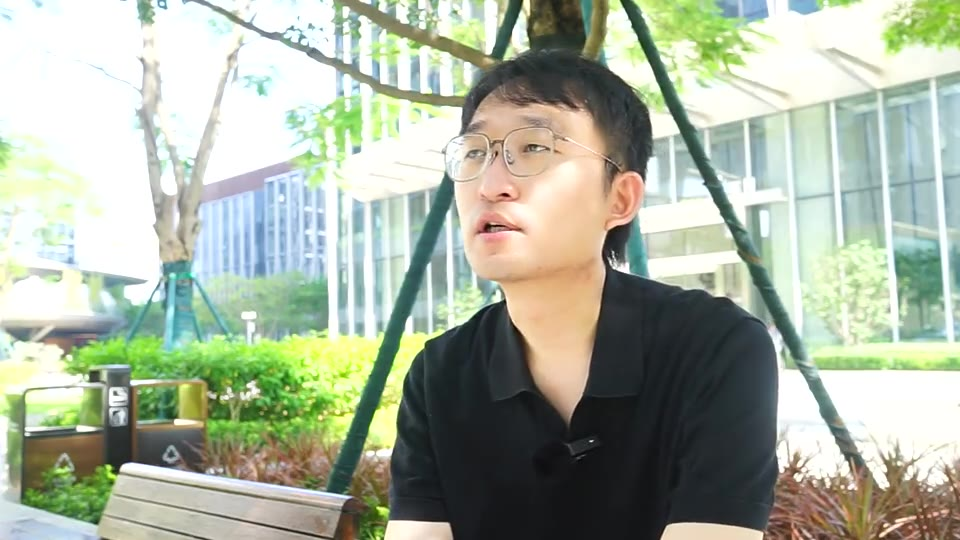
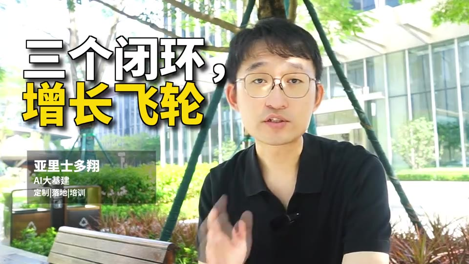
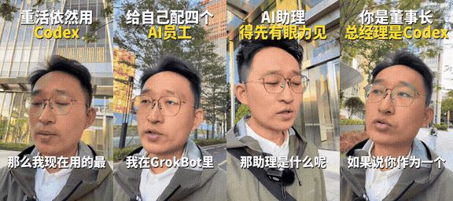
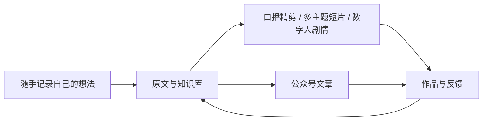

# YL Skills · 无稿口播自动剪辑，把想法变成作品

**想到哪，说到哪。把结构、顺序和删减交给 YL。**

我很多视频都没有稿子。拿起手机，像记笔记一样跟自己说话，想到什么就说什么。说错了、重复了、卡住了，继续说，先把这个想法完整地留下来。

YL 读完整段素材，找出主线，把精彩的原句放到合适的位置，删去重复、残句和无效停顿，再完成字幕、标题和封面。一次口述还可以继续变成多条视频、一篇公众号，以及下一次能调用的知识资产。

我是**亚里士多翔**，这套 Skills 来自我自己持续使用和打磨的创作流程。支持 Codex，兼容 WorkBuddy 等能够读取本地文件、执行工具的 Agent。

[开始安装](#开始使用) · [无稿口播案例](cases/talking-head.md) · [长视频拆条](cases/long-video.md) · [数字人剧情](cases/ai-dialogue.md) · [口喷转公众号](cases/spoken-to-article.md) · [知识管理](cases/knowledge.md)

## 先看一条真实的无稿口播

**11 分 16.5 秒原片 → 3 分 32.4 秒成片。** 从反复起句、边想边说，到重新安排开头、逐句删减、精剪停顿和完成包装，本例最终采用 1.1 倍速。

| 拍摄原片节选 | 最终成片 |
| --- | --- |
| [](https://github.com/user-attachments/assets/c77203df-4bed-46af-ad5d-495f44256658) | [](https://github.com/user-attachments/assets/e1639a7b-6a87-43e9-ab9c-5c1144ad3e38) |
| 原片 00:18–01:05，保留当时的起句、停顿和重复 | 完整成片 3:32，保留我的原声 |

https://github.com/user-attachments/assets/e1639a7b-6a87-43e9-ab9c-5c1144ad3e38

原来在四十多秒处才说到的判断，被提到开头。开场之后，接上“为什么我改变了看法”，再讲工具、随手记录、知识回流和发布反馈。每次调序都能回到原话和源时间，想改某一句也能继续改。

[查看完整过程、逐句对照和可复制指令](cases/talking-head.md)

## 你手里有什么，就从哪里开始

| 你遇到的问题 | 交给 YL 的材料 | 做出来的东西 |
| --- | --- | --- |
| 有观点，写稿和剪辑总把行动卡住 | 无稿口播，有重复、口误、停顿也可以 | 一条有主线、有字幕、有封面的口播视频 |
| 讲了一大段，里面好几个观点都值得单独发 | 长口播、访谈、讲座或同批连续素材 | 多条主题不同、各自能讲明白的短视频 |
| 想把观点演成剧情，暂时不想真人拍摄 | 自己的原稿、人物参考和场景想法 | 数字分身双人对话、字幕与原帧封面 |
| 说得出来，坐下来就写不出来 | 录音、口述逐字稿、已有视频定稿 | 保留原话、语气和思想推进的公众号文章 |
| 笔记越来越多，下次创作还是从头想 | 笔记、录音、文档和自己的作品 | 可回源的原文、知识原子、表达资产和观点关系 |

## 长视频剪多条，每条回答一个问题

同一批“智能体形态演变”素材，三段拍摄合计 **22 分 48.1 秒**，整理出四条不同主题的短片，并另有两条长版和一条综合版。



| 四条短片 | 完整时长 | 本页展示 |
| --- | --- | --- |
| Bot 这么火，为什么我的重活仍然交给 Codex | 1:37 | [前 18 秒](https://github.com/user-attachments/assets/d4a27f08-d491-4d5d-b6a1-69a6ce08742c) |
| 我在 Bot 里，给自己配了四个员工 | 1:14 | [前 18 秒](https://github.com/user-attachments/assets/da1a0db3-9024-4a2d-802e-ad231b39aa67) |
| 叫它 AI 助理，得先有眼力见 | 1:05 | [前 18 秒](https://github.com/user-attachments/assets/2b3d6975-f038-4887-ad08-5b3c3cffba8a) |
| 你是董事长，Codex 是总经理 | 1:20 | [前 18 秒](https://github.com/user-attachments/assets/8aafea74-a111-481d-9d97-795a893d61dd) |

先通读全文，找出不同的问题和论证，把材料分给各条视频，再分别安排开头、过程和结尾。原声选段、字幕、展示画面和封面都跟着各自的结构走。

[看这一批怎样分题、跨段调序和交付](cases/long-video.md)

## 还有三条日常创作流程

### 0 Token 数字人剧情

把自己说过的观点，改成两个人的追问与回答。已有的《普通人的捷径》样片长 **27.625 秒**，从本人原话、庭院首帧、分段生成，到本地剪辑、字幕和封面都有实际记录。

这里的 **0 Token 路线**采用视频平台网页的免费生成额度，本地完成剪辑。可用额度和模型以制作时的账号页面为准，策划与操作占用的 Agent 模型额度按宿主计算。

[](https://github.com/user-attachments/assets/ab23328f-22db-4317-829a-1f522f19044f)

[看完整样片、对白来源和制作步骤](cases/ai-dialogue.md)

### 口喷变公众号

《你天天用 AI，却连门都没进去》从一份随口录下来的思考开始，经过全文整理、第二版重写和我的十一处手改，形成认可稿。“最朴实的文字驾驭最生动的思想”“我想试试”，都能回到最初的口述。

[看口述与成稿对照、改稿过程和完整文章](cases/spoken-to-article.md)

### 知识管理，让这次表达下次还能用

同一份口述可以保留完整原文，提炼“用大白话说清思想和任务”的观点，留下自己的表达，再关联文章与视频。以后问“我以前怎么讲把 AI 当人”，能够找到原段、上下文和对应作品。

[看一份真实材料怎样进入知识库、再被调用](cases/knowledge.md)

## 开始使用

把下面这段话发给你的 Agent。

```text
请从 https://github.com/LeoAI1988/yl-skills/releases/latest
下载并安装完整 YL Skills。按安装文档核对版本和 SHA-256，
保留我的已有配置和修改，完成后验证当前宿主能调用 yl-toolbox。
```

安装后，给它一份你真正想处理的材料。

```text
用 yl-remotion-talking-head-editor 处理这条无稿口播，选半自动模式。
素材在 <我的视频位置>。
先读完整逐字稿，找主线，列出删减和调序，让我看清哪些原话被移到哪里。
确认后按原声精剪，做好字幕、标题和封面，先交本地剪辑版。
```

想直接拿到结果时，可以明确选择全自动，并说清成片要求和允许使用的外部工具。五个案例页分别提供了可直接改写使用的指令。

**运行条件**包括支持 Skills 的 Agent、Python 3.10+ 和本地文件访问能力。视频任务还需要对应的转写、FFmpeg、Remotion 或其他剪辑工具，按具体成员配置。模型、生成平台和可选画质增强按各自服务与当前权益计费。

整套安装，按任务调用。多个宿主可以共享一份核心，安装完成后刷新技能列表或新建任务。自己动手安装、升级保护与宿主映射见安装文档。[安装与升级](../README.md#安装与升级) · [最新完整发行包](https://github.com/LeoAI1988/yl-skills/releases/latest)

## 为什么把这些能力放在一起

> 复杂是执行的天敌。
>
> 人就应该做人应该做的事，机器做机器该做的事。

我的起点是降低记录的门槛。想到一个东西，就把它留下来。剪辑、成文和整理交给工作流，最后留下的作品、观点和经验，继续建设自己。



这些方法来自我的实际创作。视频号 **亚里士多翔的AI世界** 的视频使用 YL 自动剪辑，公众号 **亚里士多翔** 的文章从我的口述、原稿和知识资产出发，由 YL 整理写作。我曾在一个月做出 **10 条爆款**，这里记录的是我的个人实践。读者可以先看上面的具体作品和处理过程，再去账号里看更多内容。

完整工具箱还包含课程剪辑、封面、平台复盘、PPT 和其他工作流。成员、依赖与版本以当前发行文档为准。[全部成员](../yl-toolbox/references/catalog.json) · [许可与第三方声明](../THIRD_PARTY_NOTICES.md)

## 用起来，再把结果带回来

如果这正是你需要的工作方式，欢迎点右上角 **Star**，以后回来找案例和更新。

使用中遇到问题，可以写下你的目标、Agent、YL 版本、实际结果和报错。也欢迎带着自己的输入与输出分享使用案例。[提交问题或反馈](https://github.com/LeoAI1988/yl-skills/issues)

**English** — Chinese-first Agent Skills for unscripted talking-head editing, long-video repurposing, AI dialogue videos, voice-to-article writing, and personal knowledge management. Real examples, editable workflows, and source-grounded content. Install the complete toolkit and describe your task.

案例中的视频为适合网页查看的压缩展示版，完整片段与节选范围分别标在对应页面。作品及作者形象用于本项目案例展示，素材使用说明见案例索引。[案例与素材说明](cases/README.md)
