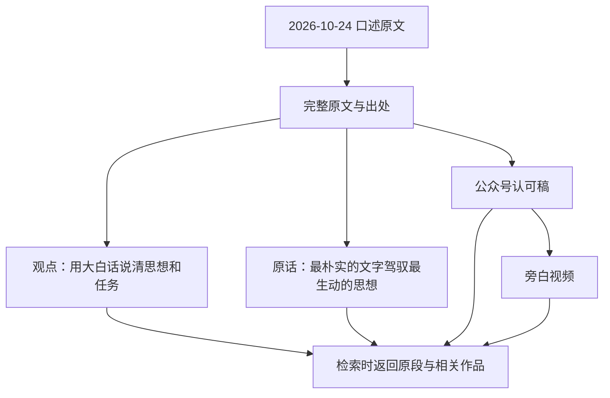

# 笔记、文章和视频，怎样成为下一次能调用的知识

作者　亚里士多翔 Aristxiang

我想要的是，每次思考都能留下来。今天录的一段话，剪成视频、写成文章以后，下次遇到相似的问题还能找得到，继续用。

所以知识管理放在 YL 的中间。录音、原文、作品、观点和表达连起来，新输出继续回流。积累越多，下一次创作能调用的东西也越多。

## 跟着同一份材料走一遍

“AI 白话文运动”这份口述，先整理成《你天天用 AI，却连门都没进去》，随后又有旁白视频。它同时留下了一个知识对象、原话表达和作品关系。



[查看原始转写节选](../examples/ai-vernacular-source.md) · [查看完整认可稿](../examples/ai-vernacular-article.md)

## 留下的内容长什么样

以下按真实知识记录选取可公开部分，原话与整理出的观点各自注明。

| 内容 | 这份材料里的实例 | 下次怎么用 |
| --- | --- | --- |
| 原文 | 2026-10-24 的完整口述转写 | 回看上下文和完整论述 |
| 知识对象 | “AI 白话文运动，用大白话说清思想和任务” | 按概念找到观点与证据 |
| 观点整理 | 用能说明真实问题的大白话协作，思想与上下文的质量影响使用深度 | 写作、课程设计和任务表达时调用 |
| 原话表达 | “最朴实的文字驾驭最生动的思想。” | 在合适语境中继续使用自己的措辞 |
| 收束表达 | “有人说你永远叫不醒一个拒绝ai的人。我想试试” | 找到当时的态度与表达方式 |
| 作品关系 | 本人认可文章、由该文制作的旁白视频 | 回看同一想法在不同载体里的展开 |

知识对象还关联了“把 AI 当人”的协作观点，并记录与“保留必要的技术判断能力”之间需要结合语境理解的差异。这样回看旧观点时，能知道当时讲的是哪一层意思。

## 整理过程做了什么

**先保存原文。** 笔记或作品保留全文、来源和版本，后续加工都能回查。

**再提炼能复用的内容。** 从完整论述中找观点、方法、案例、逻辑链和个人表达，记录适用语境。

**和已有内容比较。** 同一个观点在新作品里换了说法，可以补充来源和表达变体。确实出现了新判断，再建立对应对象。

**连到作品和思想体系。** 让原文、文章、视频、选题及相关观点之间能够互相找到。

**最后验证能不能找回来。** 检查正文、出处、引用和检索结果，确认需要的原段能被调用。文字匹配与本地中文语义检索共同支持查找。

## 记得原话和只记得意思，都可以找

这次案例整理时，实际用“无稿口播、意识流、自动剪辑、梳理逻辑”检索，找到了本人对剪辑流程的完整描述，包括哪些句子应该提前、哪些重复例子应该删掉。它帮助我把宣传重新写回自己真实做过的事情。

你可以问得很具体。

```text
用 yl-knowledge-search 找我以前怎样讲“把 AI 当人”。
给我完整原段、上下文和对应作品，保留各版本的区别。
```

也可以按意思找。

```text
找我讲过的“为什么操作越来越简单，人的思想反而更重要”。
先回读原文，再选出能支撑这个问题的段落。
```

检索返回后，写作继续以原文为依据。个人知识库使用 Markdown，可以阅读和迁移，需要时接入 Obsidian。语义模型、数据库和个人材料按安装者的环境配置。[原文检索 Skill](../../yl-knowledge-search/SKILL.md)

## 从你的第一批材料开始

适合有多年笔记、录音、文档或已发表作品的人。也可以从眼前几份材料开始，跟着之后的创作逐步累积。

```text
用 yl-knowledge 整理 <材料目录>。
先检查我的现有知识库结构，保留原文、出处和版本。
完成归档、提炼、语义去重、表达资产、观点关系和检索验证。
告诉我这次新增了什么、哪些内容补到了已有观点，以及怎样查回来。
```

录音、笔记和新作品持续进入同一条处理流程。发布后有了反馈，还可以把对应作品与表现记录关联起来，继续用于下一次选题。[知识管理入口](../../yl-knowledge/SKILL.md) · [口述转文章的前半程](spoken-to-article.md)

公众号 **亚里士多翔** · 视频号 **亚里士多翔的AI世界**

[返回首页与安装入口](../README.md#开始使用) · [更多案例](README.md)
