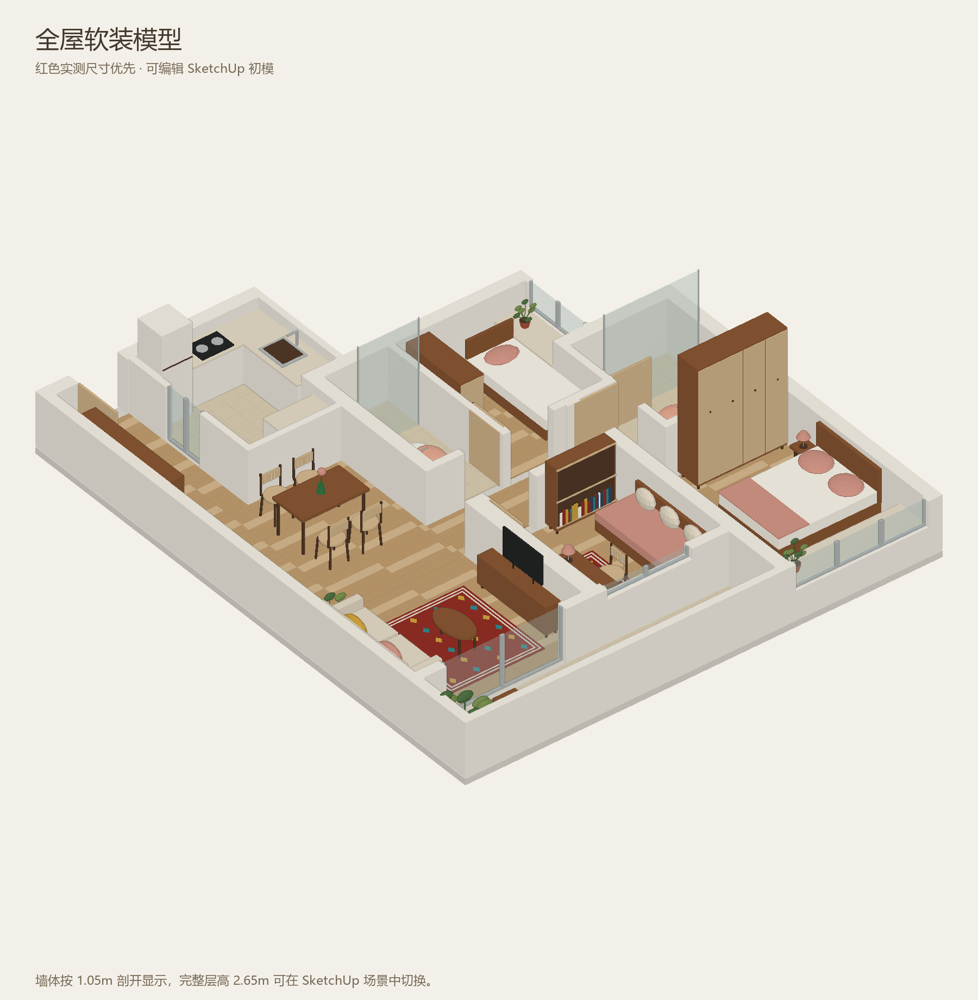
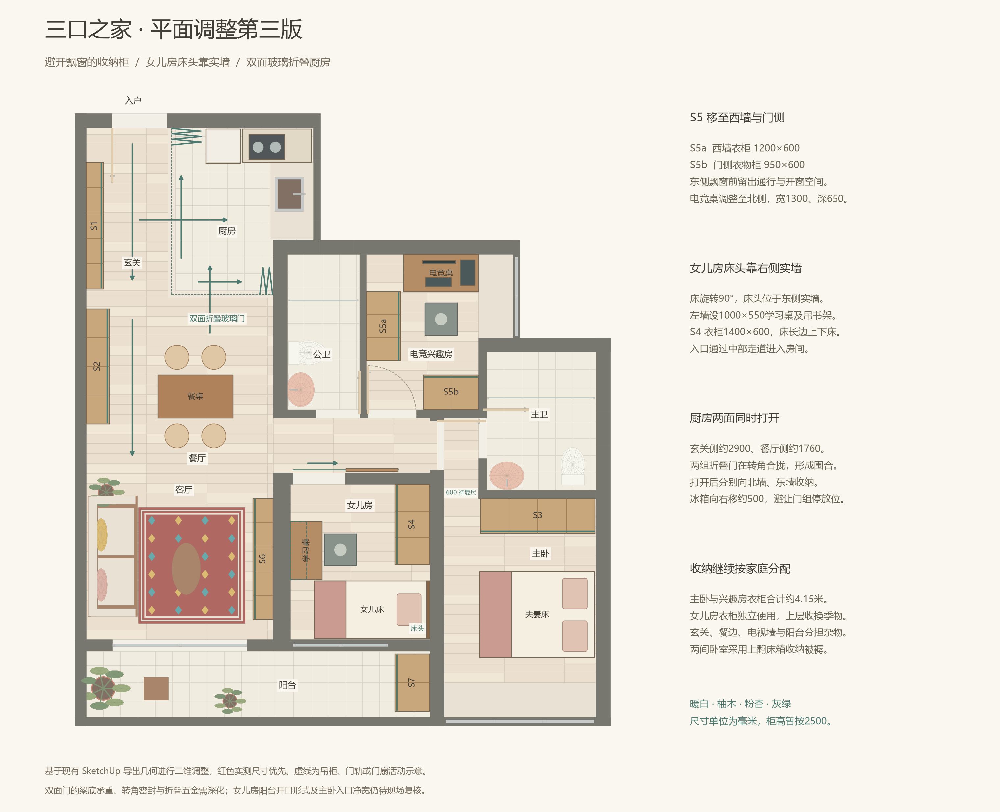
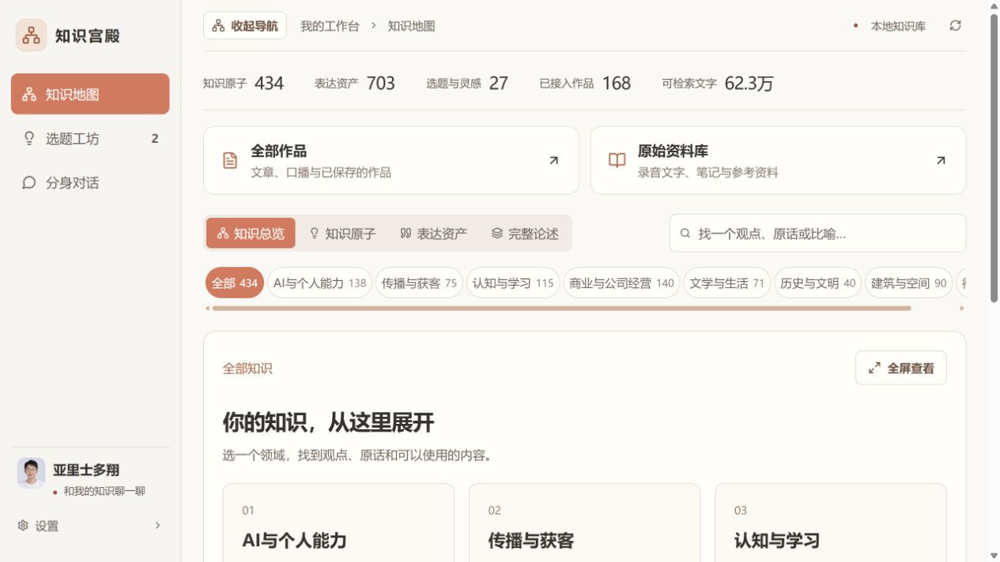

# 项目做完，让参与项目的 Codex 把过程写成公众号

作者　亚里士多翔 Aristxiang

跟 Codex 一起做项目，提过什么要求、遇到什么问题、哪一版改了什么，它都参与过。做完以后，我可以直接让它把整个过程整理成公众号。

**项目里的经历、修改意见和真实成果，就是文章的材料。**

## 我老婆让Codex做装修方案，结果我们都震惊了

这篇文章讲的是一次真实的设计测试。我老婆找来网上的户型图和装修风格照片，给 Codex 提要求，让它出参考图、建 SketchUp 初模，再一轮轮调整平面。

项目全程就在 Codex 上操作。它清楚整个流程，我直接让它整理成公众号，写作时连口述稿都没给。**最后定稿我只改了一句话，其他文字全是它自己写的，配图和排版也由它完成。**


### 做项目时发生的事，怎样进入文章

| 项目中的实际过程 | 文章里怎样讲给读者听 |
| --- | --- |
| 提供网上找到的户型图、手写尺寸和风格照片 | 交代起点，让读者知道给 AI 的材料是什么 |
| 看风格参考，纠正玄关、厨房和餐厅的关系 | 展示如何继续提意见、推进方案 |
| 指定 SketchUp，根据户型建立初模 | 展示模型与鸟瞰图，讲看到结果时的感受 |
| 加入三口之家的测试需求，增加收纳、调整房间 | 把抽象的“能改方案”写成具体问题和回应 |
| 修改挡窗的柜子、床的方向和厨房折叠门 | 用连续修改展示协作过程，再落到自己的行业判断 |

<table>
<tr><th>项目产出的 SketchUp 初模鸟瞰</th><th>文章采用的第三版平面</th></tr>
<tr><td></td><td></td></tr>
</table>

文中这样写那一轮修改。

> 她看着新平面，又发现兴趣房的 S5 柜子位置不好，会挡住开窗。女儿房的床头对着门，她觉得从风水上讲不好，希望把床的方向调整一下，床头靠实墙。
>
> Codex 接到意见，又把兴趣房的柜子拆成两组，安排在西墙和门侧，让开飘窗。女儿床旋转了90度，床头靠右侧实墙，书桌也挪到了左墙。

这一段的事情、动作和图片，都来自实际做项目的过程。户型来自网上，居住条件是本次测试设定。

文章完成后，继续选项目配图、做封面、排成可复制的公众号 HTML。从写作到配图、排版和发布，这篇都交给了 Codex。这里采用保留的定稿与配图，发布过程由作者回述。

## 知识库是为了用的，我给它做了一个可视化工作台

这篇也是 Codex 自己写的。它参与了知识工作台的开发，知道为什么要做、做了哪些功能、每个入口怎么用。项目做好以后，直接把这些经历整理成文章。



文章沿着我使用知识库时遇到的问题往下讲。

1. 文件很多，调用时却把我的东西概括成了一个没有特点的微缩版。
2. 原文、比喻和完整思考要留下来，写文章时能找回我当时怎么讲。
3. 工作台把知识、表达、作品放在能读、能找、能继续用的入口里。
4. 选题工坊接住粗糙想法，找原文、案例与表达，继续生成作品。
5. 通过自己的知识体系与数字分身讨论问题，回答还能回到原文。

文中的功能介绍直接写到怎么操作。

> 点开知识卡，可以继续看关联观点、相关表达和原始来源。这个观点用在哪些作品里，也可以顺着找过去。想拿它写东西，点“做成选题”；想接着讨论，点“问亚里士多翔”。

它还把我想保留的判断写进了文章。

> 另一个大板块是选题工坊，因为知识库最直接的用处就是进行文案创作。
>
> 把有用的内容，包装成大家感兴趣的内容。

开发记录提供功能与操作，个人知识和表达资产提供我的判断、语言与思想来路。文章配上真实工作台截图，读者就能看到它为什么有用、自己可以怎么用。[知识工作台仓库](https://github.com/LeoAI1988/yl-knowledge-workbench)

## 把自己的项目也变成内容

适合刚做完产品、插件、设计测试、业务流程或工作台的人。你已经花了时间解决一个具体问题，完整过程往往正好能回答别人也遇到的问题。

**真实项目与过程记录 → 找到读者的问题 → 梳理要求、尝试与修改 → 从自己的原话和成果成文 → 本人定稿 → 配图与 HTML → 授权发布 → 归档。**

可以把下面这段话发给参与项目的 Agent。

```text
用 yl-writing 把我们刚做完的 <项目名称> 整理成一篇公众号。
你参与过整个项目，请先回读需求、讨论、修改记录和最终成果。
讲清楚为什么做、我提了什么要求、遇到什么问题、怎么改、最后能怎么用。
使用我在项目里的原话和已有表达，选择真实成果图。
先给我 Markdown 正文，我确认后再做配图、封面和公众号 HTML。
发布时按我指定的账号与授权执行。
```

关键材料包括项目上下文、成果文件、修改意见，以及自己的写作资产。换了新聊天，也可以把这些材料交给它继续整理。[写作入口](../../yl-writing/SKILL.md)

如果想法来自一段口述，也可以从完整录音出发，保留当时的语气和思考推进。[口喷变公众号的实际案例](spoken-to-article.md)

公众号 **亚里士多翔** · 视频号 **亚里士多翔的AI世界**

[返回首页与安装](../README.md#开始使用) · [更多案例](README.md)
