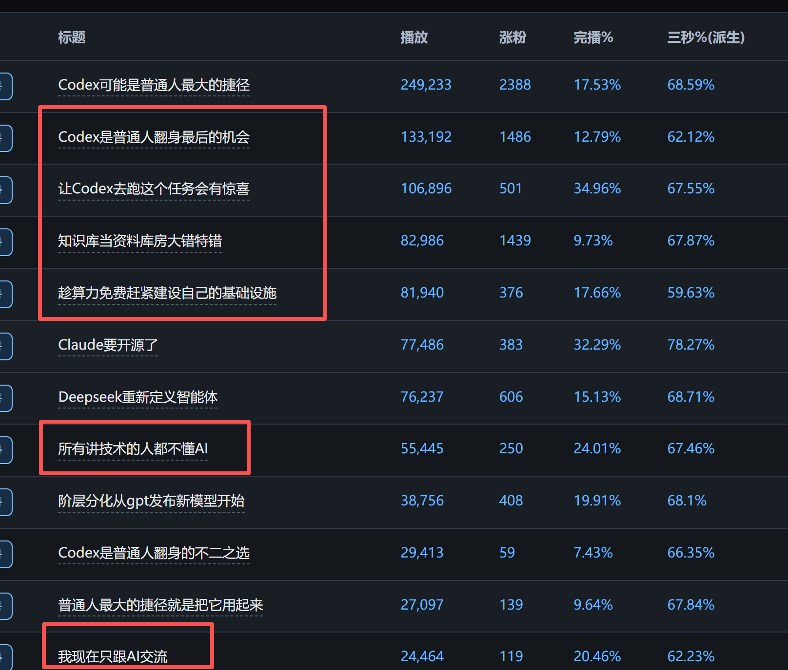

# 随口说，也能剪成一条有人看的短视频

作者　亚里士多翔 Aristxiang

我很多视频都没有稿子。拿起手机就说，边说边想，说重复了就再讲一遍，句子没接上就接着往下说。拍的时候先把想法留下来，结构、顺序和删减交给 AI 自动剪辑。

这里放三条日常竖屏口播，原片和实际发布版本放在一起，可以直接听、直接比较。

## 先看发布后的表现

账号为视频号 **亚里士多翔的AI世界**。以下是我在截图红框标出的无稿自动剪辑作品中，按播放量选出的前三条。

| 视频 | 播放量 | 涨粉 | 完播率 | 发布日期 |
| --- | ---: | ---: | ---: | --- |
| Codex是普通人翻身最后的机会 | **133,192** | 1,486 | 12.79% | 2026-09-15 |
| 让Codex去跑这个任务会有惊喜 | **106,896** | 501 | 34.96% | 2026-10-10 |
| 知识库当资料库房大错特错 | **82,986** | 1,439 | 9.73% | 2026-10-13 |

数据来自 2026-11-15 09:39（北京时间）采集的视频号作品累计数据，与下面我提供的复盘截图一致。三条作品发布时间不同，各自累计到该采集时点。播放表现来自选题、表达、剪辑和分发等共同作用。



## Codex是普通人翻身最后的机会

**1 分 58.3 秒原片 → 53.7 秒成片，133,192 次播放。**

| 随手拍摄的完整原片 | 实际发布的完整成片 |
| --- | --- |
| [](https://github.com/user-attachments/assets/1e6c5338-4466-4e0f-b569-00660656f107) | [](https://github.com/user-attachments/assets/5f7cf321-d7a0-4267-9e53-461d75372e71) |
| 118.3 秒，原速 | 53.7 秒，沿用实际成片速度 |

最后成片从这句话开始。

> 对于普通人来说，最大的捷径就是赶紧把Codex用起来，让它马上为你创造价值。

随口说的时候，一个观点会绕回来讲几次。剪辑把这一条的主线收紧到“先用起来、创造价值、建设自己的系统”，结尾留下“流水的工具，铁打的系统”。这一版沿用当时的 1.1 倍速、字幕和开拍画质增强。

左右两段可以看出，同一个人的原声、同一次表达，整理之后节奏和信息密度发生了什么变化。

## 让Codex去跑这个任务会有惊喜

**24.7 秒原片 → 16.7 秒成片，106,896 次播放。**

| 随手拍摄的完整原片 | 实际发布的完整成片 |
| --- | --- |
| [](https://github.com/user-attachments/assets/b40005a1-2b08-4e76-8c9a-0d71435b1b3f) | [](https://github.com/user-attachments/assets/5d4f90f6-5acc-4b57-bb10-1c6767fc85ad) |
| 24.7 秒，原速 | 16.7 秒，完整短视频 |

这一条就是日常想到一句用法，拿起手机说下来。内容很短，也会有自我纠正、口头重复和句间空白。

| 原片中的说法 | 剪辑后的说法 |
| --- | --- |
| 然后再列一个我们长期你跟我长期协作的一个计划 | 然后再列一个你跟我长期协作的计划 |

删掉说到一半改口的“我们长期”和重复的“一个”，把有效原声接起来。这一版由 11 段原声选段组成，应用一次 1.1 倍速，配上标题和字幕。

我只要把这件事说清楚，十几秒也能成为一条完整内容。

## 知识库当资料库房大错特错

**8 分 25.0 秒原片 → 4 分 40.5 秒成片，82,986 次播放。**

| 随口表达的原片节选 | 实际发布的完整成片 |
| --- | --- |
| [](https://github.com/user-attachments/assets/5b8b8f9d-70f7-492f-b69b-15c099ffe6bf) | [](https://github.com/user-attachments/assets/0406e5e0-1a7f-4244-be2c-0299995d6e71) |
| 原片 00:00–01:00，原速，完整原片为 8:25 | 完整 4:40.5 |

有些想法需要讲得长一点。这条从知识库的“小点点、连线、酷炫”，讲到体系如何搭建、材料按什么规则入库、怎样蒸馏，再讲知识库为什么需要精、需要准。

拍摄时先把判断和解释一起讲出来。剪辑再围绕“知识库怎样真正为自己所用”保留论述、处理重复和停顿，形成一条能完整展开观点的竖屏视频。网页展示保留当时成片的标题、字幕、剪辑顺序和速度。

同一套实践后来还写成了《知识库是为了用的，我给它做了一个可视化工作台》。项目过程、视频表达和公众号文章，可以接着往下用。[看项目成文案例](project-to-article.md#知识库是为了用的我给它做了一个可视化工作台)

## 你可以怎么开始

适合有经验、有判断，拿起手机就能讲几句的人。拍一段日常观点、工作感受或操作心得，把完整素材交给 YL。

```text
用 yl-remotion-talking-head-editor 剪这条日常无稿口播。
素材在 <视频位置>。这是我随口说的，请先读完整逐字稿。
找出主要观点，保留我的原话和完整意思。
处理口误、重复和无效停顿，必要时调整原句顺序。
把删减、调序和建议的时长先给我看，确认后做字幕、标题和封面。
```

如果希望直接拿到结果，可以明确选择全自动，并说明成片要求。需要删哪句话、换哪个开头，也能继续按原声修改。[口播剪辑 Skill](../../yl-remotion-talking-head-editor/SKILL.md)

本页六段视频均为实际素材的网页压缩副本，前两组原片和三条成片完整展示，第三组原片展示前 60 秒。原片做了适合浏览器观看的 HDR 转 SDR，成片保留既有包装。

视频号 **亚里士多翔的AI世界** · 公众号 **亚里士多翔**

[横屏长口播的调序过程](talking-head.md) · [长视频拆多条](long-video.md) · [返回首页与安装](../README.md#开始使用)
