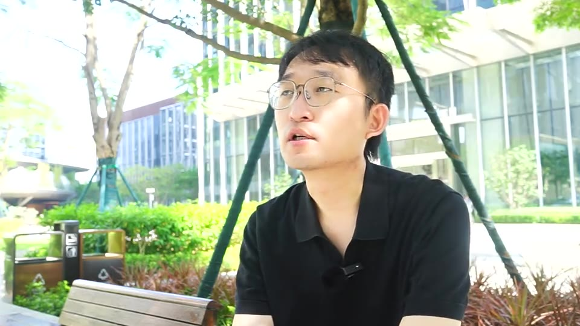
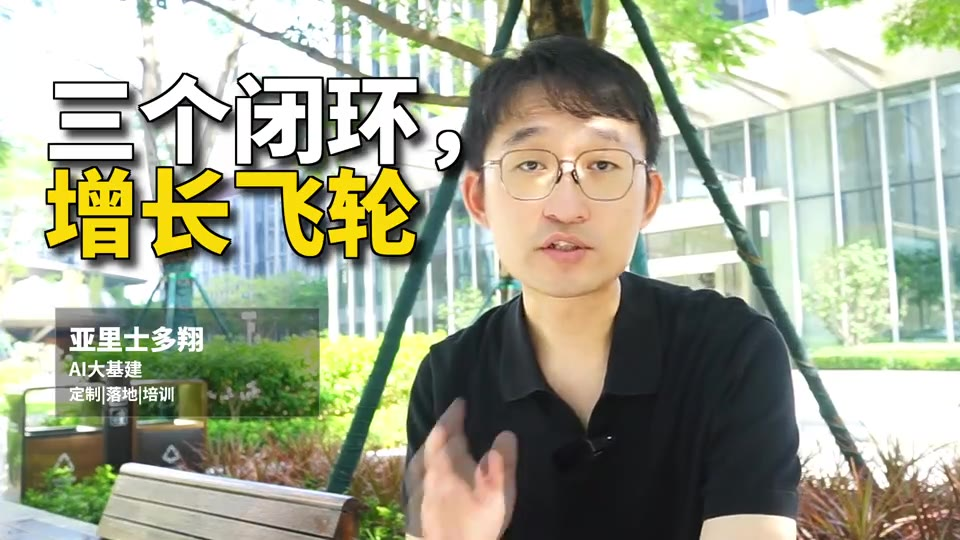

# 无稿口播也能剪成一条有结构的视频

作者　亚里士多翔 Aristxiang

我很多视频没有稿子。一个念头冒出来，拿起手机就说，想到哪说到哪。说错了继续说，卡壳了接着想，先把这个想法讲完。

真正让我轻松下来的，是把“组织成片”交给了剪辑流程。录的时候可以专心思考，录完再从完整逐字稿里找到主线、调整顺序、删掉多余的表达。

## 看原片，再看成片

| 原片节选 | 完整成片 |
| --- | --- |
| [](https://github.com/user-attachments/assets/c77203df-4bed-46af-ad5d-495f44256658) | [](https://github.com/user-attachments/assets/e1639a7b-6a87-43e9-ab9c-5c1144ad3e38) |
| 原片 00:18–01:05，原速 | 完整成片 03:32.4，最终采用 1.1 倍速 |

这条拍摄原片长 **11 分 16.5 秒**，内容是我如何从怀疑自动剪辑，到用它重构自己的创作流程。最终成片长 **3 分 32.4 秒**，1920×1080，完成原声精剪、标题和身份卡包装。网页提供压缩版，方便直接查看。

### 播放原片节选

https://github.com/user-attachments/assets/c77203df-4bed-46af-ad5d-495f44256658

### 播放完整成片

https://github.com/user-attachments/assets/e1639a7b-6a87-43e9-ab9c-5c1144ad3e38

## 原来是怎么说的

原片一开始有几次没有说下去的起句，之后才进入正式表达。下面按存档转写保留节选，时间用于回看原片。

| 原片位置 | 当时的表达 | 实际处理 |
| --- | --- | --- |
| 00:18–00:22 | “上周啊我做了一个”“上周啊” | 删掉失败起句 |
| 00:26–00:36 | “最近啊，我被打脸了……我看很多 AI 博主在说自动剪辑……” | 保留必要背景，安排到强开头之后 |
| 00:43–00:55 | “自动剪辑、数字人这些东西……它只能解决你懒的问题，它解决不了你蠢的问题。我以前是这么说的，但是我最近打脸了……” | 作为开场的判断与转折，清理中间重复和赘词 |
| 后续全文 | 工具能力、剪辑消耗、随手记录、知识回流、发布反馈 | 按完整论证组织，逐句删留与精剪 |

现在观众一进来，先听到一个明确判断，紧接着听到我为什么改了看法。早先的背景有了放置的位置，整条视频也有了往下看的理由。

## YL 怎样把它做出来

### 先把全文看完

提取带时间的逐字稿，识别说错后重说、句子说了一半、同一个观点反复解释，以及观众需要先知道的前提。我要讲什么，必须先从整段表达里看清楚。

### 再决定留下什么、先说什么

为每一段注明保留、删去或移动，移动时保留原位置和新位置。强开头从我已经说过的原句里找，后文需要的条件、解释和转折一起保留。

这次采用半自动流程，我看过逐字稿并给过多轮修改。第一轮方案之后，恢复了需要的内容，第二轮把开头整块前置，第三轮继续做具体删减。这个过程允许我保留自己的判断，也允许我指定“这句话放回来”“这一段太啰嗦”。

### 把文字决定落实到原声

按原片时间定位字词，剪掉失败起句、无信息停顿、重复与残句，保留完整字音和自然气口。每次调序之后，音频、画面和字幕共用同一条时间线。

本例最终记录了 **154 组剪辑片段**，统一按 1.1 倍速处理。本页展示保留的标题包装版。时长变化包含内容删减、停顿收紧和倍速。

### 做好包装，再按反馈修订

加标题、字幕和身份卡，检查字有没有遮住脸、字幕有没有裁切、切口有没有吞字。后续只改标题或字幕位置时，可以沿用已确定的剪辑结构。

## 你可以这样用

适合个人创作者、知识分享者、顾问和创业者。你已经有经验与观点，希望把手机里零散拍下来的表达做成能发布的作品。

给 Agent 一段真实原片，以及你喜欢的成片样式。可以附上必须保留的观点和希望达到的时长。

```text
用 yl-remotion-talking-head-editor 剪这条无稿口播，选半自动模式。
原片在 <文件位置>，参考样式在 <参考位置>。
先读完整逐字稿，找出我真正要表达的主线。
逐句标出删减，写清楚需要调序的原句、原位置和新位置。
保留我的原声、措辞和必要的推理，清理失败起句、重复与无效停顿。
等我确认文字方案后，精剪并做字幕、标题和封面，先交本地剪辑版。
```

已经确定风格，想批量交给 Agent 时，可以明确选择全自动，给出材料范围、交付要求和允许的工具。制作所需转写、剪辑与可选增强依赖按你的环境配置。[对应 Skill](../../yl-remotion-talking-head-editor/SKILL.md)

## 剪完，这次思考还可以继续用

最终逐字稿可以继续写成公众号，观点和表达可以进入知识库。下一次创作时，再把这次想清楚的东西调出来。[口喷转公众号](spoken-to-article.md) · [知识管理](knowledge.md)

本例依据 2026-09-23 的多轮修订记录、保留原片和最终成片整理。历史流程使用过 ChatCut 与本地处理，当前口播入口使用 Remotion 工作流。

视频号 **亚里士多翔的AI世界** · 公众号 **亚里士多翔**

[返回首页与安装入口](../README.md#开始使用) · [更多案例](README.md)
