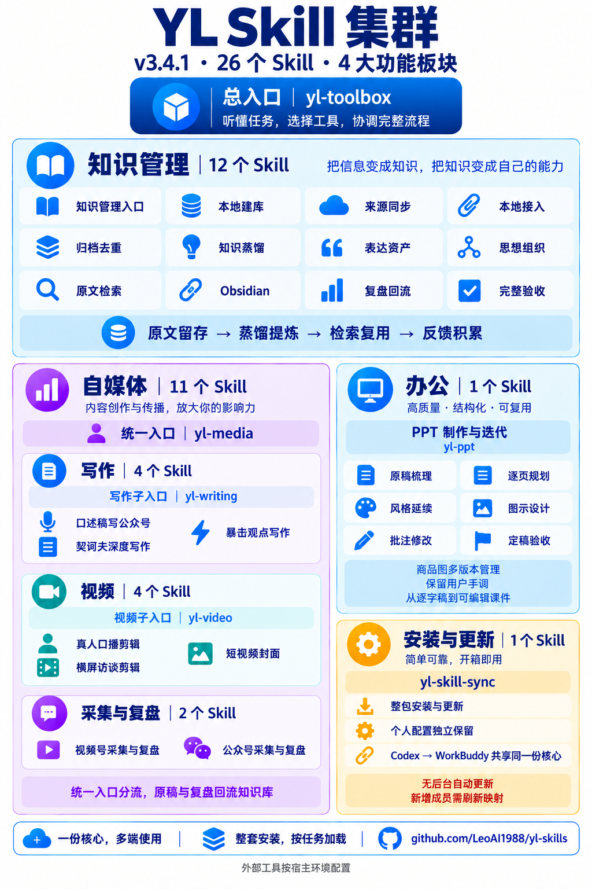

# YL 工具箱

版本 **3.4.1**，共 **26 个 Skill**。整套安装，内部模块化，按任务加载。日常使用与同版本发行包共用一套通用核心；个人配置独立留在本地，升级不会覆盖。远端下载附件以实际发布版本为准。

## 能做什么

| 板块 | 入口 | 能力 |
|---|---|---|
| 知识管理 | `yl-knowledge` | 建库、来源同步、本地接入、归档去重、原子/表达、思想树、检索、Obsidian、复盘回流、验收 |
| 自媒体 | `yl-media` | 统一统筹写作、视频、封面与视频号/公众号采集复盘；内部由写作、视频子入口分流 |
| 办公 | `yl-ppt` | PPT 逐页规划、参考风格、关系图、批注迭代、商品图多版本及定稿验收 |
| 安装更新 | `yl-skill-sync` | 整包安装/升级、校验、其他宿主共享映射 |

四大板块：知识管理 12 项、自媒体 11 项、办公 1 项、安装与更新 1 项，另有总入口 1 项，共 26 个 Skill。写作与视频通过 `yl-media` 统一进入，不再作为平级板块。

知识管理是 1 个分类入口＋11 个功能成员。用户说“同步/导入”默认走到蒸馏、去重、表达、体系与检查，不必另说“蒸馏”。只有数据改变不重复提炼正文。语义判断由 Agent 完成，脚本不冒充理解；缺原文、工具或核验时明确报告部分完成。

原文检索使用全文匹配＋免费本地中文语义模型，返回完整原段与出处，包括未形成原子的内容。模型、数据库、来源清单和个人语料保存在核心外，依赖安装和模型下载需明确授权；不默认上传正文或调用收费接口。配置与验证见 [检索说明](yl-knowledge-search/references/retrieval.md)。

## 安装与升级

从 [GitHub Releases](https://github.com/LeoAI1988/yl-skills/releases/latest) 取得整个 ZIP 和 SHA-256，核对版本和校验值后安全解压。源码、发行包与本地安装分别标记版本；以实际下载附件为准。

Python 3.10+，从完整发行目录执行：

```text
python -B install.py --target /your-agent/skills --dry-run
python -B install.py --target /your-agent/skills
python -B install.py --target /your-agent/skills --upgrade
```

首次冲突、未登记旧入口、被私改的核心会拒绝覆盖。迁移旧版先比对能力、保存个人设置及恢复副本；正常升级只替换登记的未改核心。退出的成员移到恢复目录，不永久删除。

其他 Agent 不重复安装，映射到主安装（常用为 Codex）：

```text
python -B yl-skill-sync/scripts/sync.py map --target /codex/skills --map-target /workbuddy/skills --dry-run
python -B yl-skill-sync/scripts/sync.py map --target /codex/skills --map-target /workbuddy/skills
python -B yl-skill-sync/scripts/sync.py status --target /codex/skills --map-target /workbuddy/skills
```

Windows 用 Junction，其余系统用符号链接。维护者可使用根安装器 `--link` 将主安装指向长期核心目录；不能指向临时解压位置。已链接成员跟随主安装的同一份文件更新；新增成员仍需再次运行 map，不能只靠旧链接自动发现。安装后刷新客户端技能列表或新建任务核对真实调用。

安装成员支持显式 HTTPS ZIP＋独立 SHA-256 下载、持久缓存和安全解包，再使用随自身审核的安装器；没有后台自动更新。不会自动安装第三方软件、转写模型或开通账号。

## 个人配置

定位：命令 `--profile` → `YL_PROFILE` → `~/.config/yl-toolbox/profile.json`。详情见 [配置约定](yl-toolbox/references/profile.md)。个人路径、来源库名、工具位置、排除材料、领域和表达偏好在这里；凭据使用安全存储/环境变量。

首次建库明确选择沿用现有结构或新建推荐结构。Get 有只读连接器；Notion、飞书等使用宿主已授权接口或导出文件，不能把预留适配当已验证原生同步。没有 Obsidian，Markdown 知识库仍可使用。

统一流程、蒸馏质量和排名属于核心方法，不放个人开关。视频评分：完播率百分位35%＋平均播放时长百分位20%＋万播放涨粉百分位10%＋涨粉数百分位25%＋三秒完播率百分位10%；五项均为组内百分位，分数上限100。详见 [评分约定](yl-media/references/ranking.md)。

## 使用

- “把这三个笔记库同步到本地”：完整处理新增/修订本人语料。
- “帮我建立本地知识库”：提供沿用/新建选择并创建可读结构。
- “从我的知识库找相关观点”：只读检索并回读原文。
- “复盘视频号和公众号”：采集、分析、作品/选题回流、新文稿蒸馏。
- “用这份逐字稿做 PPT，风格参考上一节”：进入 `yl-ppt`，按要求先出逐页方案或直接制作。
- “按批注修改两版 PPT”：保留最新手调，按版本差异矩阵修改和核验。
- “用我的口述稿写公众号”：在本人原稿上修补，按需检索原子和表达。

写作风格不是冒充作者，真实原话与本人事实优先。双模式封面保留黑底白字和半透明选择；个人头像由本地配置提供，不随包分发。

## 维护与许可

[维护流程](MAINTAINING.md)、[架构说明](PRD.md)、[当前成员目录](yl-toolbox/references/catalog.json)。旧来源快照是方法出处/历史比较，不是继续调用散装版的入口。

整包为多许可源码集合，不能统称无限制商用 MIT。写作公共层及部分剪辑方法含 CC BY-NC 4.0，契诃夫语料有逐文件授权，详见 [第三方声明](THIRD_PARTY_NOTICES.md) 及各成员原有 LICENSE/NOTICE。用户创作物不因使用工具自动改授源码许可。

分享整个 `yl-toolbox-cluster.zip`，不要分拆散装成员。公开仓库 [LeoAI1988/yl-skills](https://github.com/LeoAI1988/yl-skills)，本地构建不自动推送或发布。当前宣传图：


