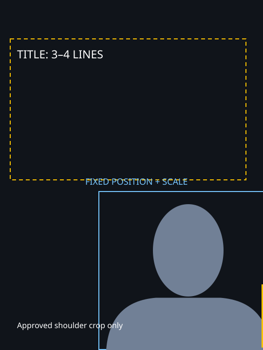

# 固定人物底板

当个人配置 `video.covers.portrait_layout_file` 存在，先打开该 JSON 的 `referenceImage`，使用同一人物底板完成整批封面。固定底板优先于本成员历史默认的右移/缩放值和“随文字微调人像”。本人真实人物、底板图和私人路径留个人层，不放通用核心。

上图仅为无身份的几何示意；真实校准必须打开个人配置指向的无字底板图，不得把示意当作已认可人物素材。

- 标题按个人 `minTitleLines` 执行；当前底板要求至少三行时，不能输出两行。用户指定三/四行必须逐字保留。
- 人物头脸完整，肩部位置按用户最新确认的标线校准。默认肩部不越界；用户明确要求局部裁肩时，记录 `approvedRightCropPx` 的精确裁切量并建立新版底板，不能继续套用旧的“必须完全留出右肩”位置，也不能自行扩大裁切或缩放人物。
- 底板确定后，位置和大小固定；默认允许位移与缩放变化均为零。更换标题只调整文字的断行、字号与坐标，不为每一张封面重定位人物。
- 画布、头像哈希、固定 x/y/高度、右边距和无字底板图均入配置。更换头像、画布或用户明确要求重设底板时才建立新的版号，不能静默漂移。
- 渲染传 `--portrait-layout <个人配置指向的JSON> --avatar <匹配头像>`；不得同时传 `--avatar-scale/--avatar-x-shift/--avatar-y-shift`。
- 校验传相同独立配置：`validate_bold_cover.py --portrait-layout <JSON> ...`。校验核对配置哈希、头像、实际坐标/尺寸、人物蒙版哈希与参考图哈希；没有独立配置不能放行固定人物清单。
- 本批所有封面的 `fixedPortrait` 中 x/y/width/height/pixelMaskSha256 必须一致。逐字遮挡超限时重排文字，不能移动人物来绕过校验。

底板 JSON 字段：`canvas`、`avatarSha256`、`x`、`y`、`height`、`minRightMargin`、`approvedRightCropPx=0`（用户明确裁肩时才改）、`minTitleLines`、`referenceImage`、`maxMovementPx=0`、`maxScaleChange=0`。尺寸不符、实际裁肩量与批准值不同、头像不符或参考图缺失均拒绝渲染。
